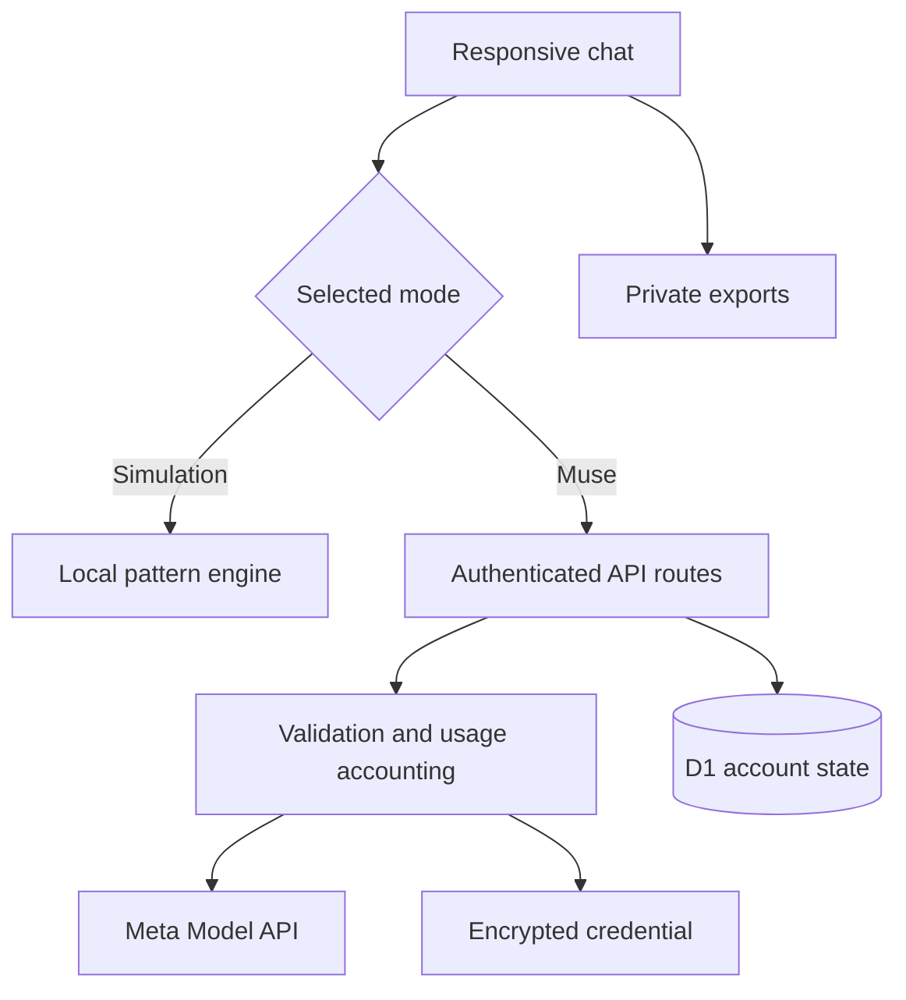

# SewaJelas

**Current application version: 0.4.5** · [Changelog](CHANGELOG.md) · [Master handover](MASTER_HANDOVER.md)

Version headings below describe when features were introduced; they are not the current application version. Check `package.json` and `lib/studio.ts` for the current version.

**Know the trade-offs before you rent.** An Indonesian rental-assistant rehearsal studio prepared for a proposed Meta Global AI Developer Hackathon submission.

SewaJelas starts from a personal problem: a cheap rental can hide unreliable water, damp rooms, extra fees and unclear repair responsibilities. The long-term product helps renters compare evidence without making landlords relist their properties.

**This release is a supervised rental-assistant MVP.** It stores an editable housing profile/current goal and can search public web sources after explicit approval. It does not provide unrestricted social-platform access, contact landlords, negotiate or take payments. Hackathon eligibility and final submission requirements remain to be confirmed.

## What works now

- Mobile-friendly Indonesian chat for renter interviews and landlord roleplay.
- Explicit free pattern-based simulation and a separate Muse Spark API mode.
- Feedback, example rewrites and regeneration; eight recent active style guidelines enter the model context. This is **not fine-tuning**.
- Per-account history, saved lessons, revision checks and Markdown/JSON exports.
- Server-side provider requests, encrypted account-scoped credentials and daily usage accounting without an application-imposed daily cap; provider rates and limits still apply.
- Twenty-seven automated tests covering actual route handlers, isolation, quotas, encryption, exports and a mocked provider contract.

**Validation boundary:** tests use an explicit Meta mock. The owner reports successful real Muse conversations; the developer regression suite uses synthetic data and has not independently repeated a live-provider call for this release. Current summaries extract quoted snippets rather than verified rental facts. See [validation](docs/VALIDATION.md).

## Try the current web app

[SewaJelas — Ruang Latihan](https://sewajelas-ruang-latihan.tamecreek.chatgpt.site) is access-restricted. It is not yet a judge-accessible public demo.

1. Sign in with an account granted access by the project owner.
2. Enter rental needs in Indonesian. Simulation works without a provider key but is deliberately limited.
3. For the real model, choose **Simulasi → Kunci API Meta → Hubungkan & uji**. Supply your authorized Meta API key through the app, never through a repository or conversation export.
4. Use **Perbaiki gaya**, provide feedback and an example, then retry. Review history and export rehearsal data.

ChatGPT sign-in supplies application identity; it does not supply Meta API credit or turn simulation into a language model. Arrange reviewer access and a funded, bounded live demo before submission.

## Meta integration

`lib/server.ts` calls `https://api.meta.ai/v1/chat/completions` with a supported account-selected Standard Muse Spark model (default `muse-spark-1.3`), a `developer` message, bounded history, `reasoning_effort: minimal`, and a completion-token cap. Keys never enter prompts or client responses. Failures are surfaced; failed live requests do not silently become simulated answers.

Protocol reference: https://dev.meta.ai/docs/protocols/chat-completions . Actual credential access and output quality still require a live test.

## Architecture



React + Vinext runs on Cloudflare Workers with D1 storage. Production depends on a trusted Sites authentication gateway. **Do not expose the Worker with client-controlled identity headers.** Other hosts need an equivalent verified authentication boundary.

## Local development

Use Node 24 for the SQLite harness and the pnpm version pinned in `package.json`.

```sh
pnpm install --frozen-lockfile
pnpm typecheck
pnpm test
pnpm build
pnpm exec wrangler d1 execute DB --local --config dist/server/wrangler.json --file drizzle/0000_magenta_echo.sql
pnpm dev
```

The migration command targets a **new local database**, not an existing production database. Portable development offers a loopback-only mock sign-in; this is not production authentication. Tests and simulation need no real key. For local live tests configure an uncommitted `APP_VAULT_KEY` in the Worker environment, then enter a Meta key through the UI. Preserve the vault secret while encrypted keys must remain readable.

The original deployment identifier is removed. Bind your own project and D1 before deploying. See [operations](docs/OPERATIONS_ID.md) and [security](SECURITY.md).

## Repository guide

| Path | Purpose |
| --- | --- |
| `app/`, `lib/`, `db/`, `drizzle/` | UI, routes, prompts, schema and migration |
| `tests/` | Actual-handler harness with SQLite-backed D1 substitute |
| `docs/PRODUCT_REVIEW_ID.md` | Indonesian audit, priorities, photo-card design and Telegram roadmap |
| `docs/HACKATHON.md` | Verified information and outstanding submission gates |
| `docs/DEMO_SCRIPT.md` | Suggested demo narrative |
| `docs/EVALUATION.md` | Live test cases and results template |
| `docs/LISTING_CARD_CONTRACT.json` | Proposed card example, not implemented functionality |
| `docs/PROVENANCE.md` | Source revision and packaging changes |

## Next milestone

Interview → editable brief → source-attributed cards with up to three genuine available photos → unresolved questions. Start with authorized materials or clearly labelled fixtures. Telegram is an optional later adapter after the web journey works.

No immunity to prompt injection, property inspection guarantee, damage forecast or universal access to Meta listings is claimed. Original platform photos do not prove current property condition or image authenticity.

## Licensing

No project-wide open-source license has been selected by the owner. Existing third-party notices remain in `vendor/` and `scripts/vite/`. Repository availability does not grant rights to third-party property photos or datasets.

## Release history: version 0.2.0

Muse mode survives reload and temporary connection failures. Live requests use every stored turn in the active session (up to 80,000 characters, with an explicit overflow error). Server-side response persistence allows recovery after a lost response without repeating a completed normal request. JSON export includes all saved sessions, counts, revision history, draft, mode and sync metadata. Message actions support copy, select and device sharing where available.

See [changelog](CHANGELOG.md), [handover](HANDOVER.md) and [validation](docs/VALIDATION.md). Committing to GitHub does not automatically publish to Sites; maintain both release steps. Credentials and private user transcripts must never be committed.


## Release history: version 0.3.0

Chat labels now show the complete model name; user-name labels and inline copy buttons are removed. Open ⋯ or hold a message for copy/select/share. A floating upper-left drawer contains navigation and the rehearsal disclosure. Click the model header, then **Periksa model dari API key** to load compatible account models and choose Standard Muse Spark 1.1–1.3. A selection changes future replies; past replies keep their recorded model. Contributor/image/audio models are not automatically enabled.

## Release history: persistent profile and supervised discovery (introduced in 0.4.0)

Open the floating menu → **Profil & tujuan**. A single current rental goal and eight housing fields are stored across sessions. Saved renter chats use one structured-output call for both the reply and evidence-bound profile updates. Since 0.4.1, an explicit request to save an interview can use evidence from earlier user messages in the same session. Manual edits lock fields by default; automatic memory can be disabled. Owner roleplay never updates the real renter profile. This is prompt memory, not training model weights.

In a renter chat, ask to search, review the exact query in the conversation, then select **Setuju, lanjutkan** or **Batal** in the chat. The app uses Meta Responses `web_search`, stores an approval/job before invoking it, and renders HTTPS Facebook/Threads/Instagram source cards only from provider citation annotations after a confirmed tool call. This is public-web discovery, not a direct Marketplace integration or comprehensive coverage. API credit is required even when the conversational mode is free simulation. Only the approved query is sent to search, not the private profile/history. The model may perform multiple internal searches in one Responses request.

Profiles, goals, sources and search logs are included in JSON exports. Chat history and encrypted credentials remain account scoped. Maximum 30 retained search jobs; no automatic retry of an approval ID. A running job after an interrupted process is unconfirmed and must not be presented as completed.

Autonomous production tasks are deferred: first implement an explicit task scope, time/budget limits, cancellation, queue, provider permissions and separate outreach approval. Search approval is not permission to contact, book or pay. Listing photos and Telegram are not shipped.

Official protocol references: https://dev.meta.ai/docs/structured-output and https://dev.meta.ai/docs/search-grounding . New live structured-output/search access is not independently tested with the owner's key; route and UI tests use synthetic data.

## Updates after 0.4.0

- **0.4.1:** Explicit requests to save interview results can use evidence from earlier user messages in the same session. Locked fields remain protected. Live-provider behavior still needs real-account testing.
- **0.4.2:** Removed the app's 20-attempt daily cap. Daily usage counting remains; Meta's provider limits and charges still apply.

This README is maintained separately from the deployed Site. A documentation-only commit does not itself update the live app.

- **0.4.3:** More resilient handling for structured profile replies and honest confirmation of saved changes. Real-key verification remains pending.

- **0.4.4:** Search requests, query review, consent and results are handled within the same chat. Intent recognition is rule-based and live-provider search remains to be verified.

- **0.4.5:** Search approval and cancellation buttons appear inside the conversation; decisions remain subject to server-side checks.
