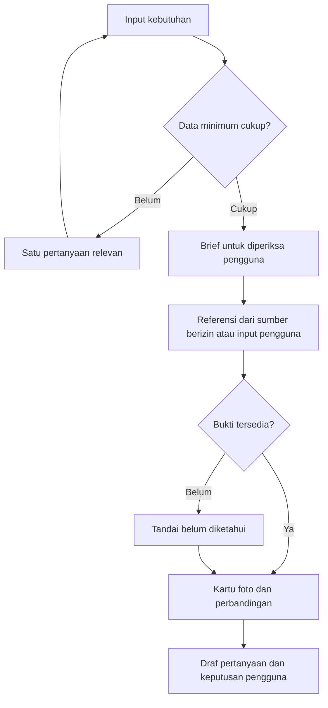

# SewaJelas: audit produk dan rencana MVP

Tanggal: 3 November 2026. Audit source rilis `9127d6a0226b0f8e9010bcca5a4b73a169d00d40`. Dokumen ini membedakan hasil yang sudah tersedia dengan rancangan berikutnya. Belum ada pencarian listing atau pengiriman pesan ke pemilik di aplikasi sekarang.

## Keputusan produk

SewaJelas paling kuat sebagai **asisten keputusan sewa yang membantu menemukan informasi yang belum jelas**. Masalah pengguna bukan hanya kekurangan listing: informasi tentang air, biaya tambahan, kelembapan dan tanggung jawab perbaikan sering baru diketahui setelah pindah. Nilai produknya adalah mengubah obrolan dan bukti menjadi keputusan yang bisa diperiksa.

Tidak perlu membuat katalog publik, mengajak pemilik memposting ulang, atau menjadi marketplace. Namun sebuah kasus privat tetap perlu menyimpan referensi listing, kutipan, sumber dan status pertanyaan agar percakapan tidak kehilangan konteks. “Tanpa katalog publik” tidak berarti “tanpa penyimpanan data”. Retensi dan penghapusan harus terlihat oleh pengguna.

Posisi yang disarankan: **Cari yang cocok. Ketahui kekurangannya sebelum menyewa.** Hindari janji “pasti jujur”, “bebas penipuan”, “foto pasti bukan AI”, atau prediksi kerusakan enam bulan tanpa inspeksi. Foto sumber pun belum membuktikan kondisi saat ini.

## Kekuatan dan kelemahan

| Temuan | Implikasi |
| --- | --- |
| Masalah dialami sendiri dan sangat konkret | Demo dapat dimulai dengan biaya sewa murah tetapi air bermasalah; manfaat mudah dipahami |
| Checklist disesuaikan kebutuhan tiap penyewa | Lebih bernilai daripada rangkuman iklan generik |
| Perbaikan gaya, riwayat, dan ekspor sudah tersedia | Ada jalur iterasi dengan penguji tanpa fine-tuning mahal |
| Mode simulasi menghasilkan pola berulang | Label mode belum cukup mencegah ekspektasi keliru; jawaban “sewa saja” harus memajukan state |
| Ringkasan masih mengambil cuplikan berdasarkan pola | Bisa mempertahankan angka lama setelah koreksi; belum menjadi brief keputusan |
| Belum ada alur dari kebutuhan menuju kandidat hunian | Saat ini produk adalah ruang latihan, bukan agen pencarian selesai pakai |
| Akses data dan foto tergantung sumber serta izin | Jangan menjadikan scraping seluruh Meta sebagai syarat demo yang berisiko gagal |
| API nyata belum diuji pada rilis awal | Hasil mock tidak membuktikan kualitas Muse atau kelayakan demo live |
| Netralitas belum memiliki model bisnis | Komisi pemilik kelak dapat menciptakan konflik; ranking dan sponsor wajib dibedakan |

## Prioritas dengan waktu terbatas

| Urutan | Peningkatan | Selesai jika | Estimasi kerja fokus* |
| --- | --- | --- | --- |
| P0 | Uji Muse nyata, status mode yang jelas | Satu sesi lengkap memakai provider nyata, gagal API terlihat, tidak berpura-pura live | 1–2 jam jika akses API tersedia |
| P0 | Interview dengan state terstruktur | Budget + periode + cakupan biaya + lokasi + kebutuhan wajib disimpan; koreksi menimpa nilai lama; tidak mengulang pertanyaan terjawab | 2–3 jam |
| P0 | Brief yang bisa disetujui/diedit | Pengguna melihat kebutuhan wajib, preferensi fleksibel, dan hal yang belum diketahui | 1 jam |
| P1 | Kartu referensi dengan maksimal tiga foto | Dua kandidat dari sumber berizin atau fixture bertanda jelas dapat dibandingkan tanpa klaim pencarian nyata | 2–3 jam |
| P1 | Ringkasan risiko dan pertanyaan pemilik | Tiap simpulan terhubung ke bukti; kondisi yang tidak diketahui menjadi pertanyaan, bukan fakta | 1–2 jam |
| P0 | Bukti demo dan akses juri | Link dapat dibuka reviewer yang dimaksud, source bisa dibangun, demo tidak membocorkan data/kunci | 1–2 jam |

*Estimasi, bukan janji. Bila waktu tersisa sangat singkat: selesaikan uji nyata, interview, brief, dan bukti demo. Jangan menambah Telegram, negosiasi otonom, pencarian seluruh platform, atau redesign besar pada saat yang sama. Sisakan setidaknya dua jam sebelum batas pengumpulan untuk gangguan dan upload.

## Alur sasaran MVP web berikutnya

Diagram ini adalah target pengembangan, bukan daftar fitur yang telah selesai. Pada rilis latihan, keluaran berhenti di percakapan, ringkasan cuplikan, dan ekspor.

## Interview yang terasa manusiawi

Simpan state eksplisit, misalnya `rentAmount`, `rentPeriod`, `budgetScope`, `area`, `moveIn`, `mustHaves`, `flexiblePreferences`, `unresolved`. Setiap nilai memiliki kutipan pesan asal. Gunakan satu panggilan model untuk balasan dan usulan perubahan state; validasi schema server, bukan regex semata. Jangan menambahkan satu panggilan rangkuman pada setiap giliran.

Contoh: “Lima juta, sewa saja” belum cukup tanpa periode. Pertanyaan berikutnya: “Lima juta itu per bulan atau per tahun?” Setelah pengguna menjawab “per bulan”, jangan menanyakan lagi apakah sudah termasuk listrik. Jika ia mengubah menjadi empat juta, tandai nilai terbaru dan hitung ulang kecocokan.

Jika pengguna tidak tahu, simpan `unknown` dan lanjutkan bila bukan penghalang. Pertanyaan teknis seperti PDAM vs sumur hanya diprioritaskan bila relevan pada kebutuhan atau kandidat, bukan formulir panjang sejak awal. Hormati bahasa santai; tidak perlu mengulang sapaan atau “baik, saya memahami” setiap balasan.

## Ide tiga foto: setuju, dengan fungsi yang jelas

Kartu di dalam chat berisi judul singkat, area, harga beserta periode, biaya tambahan/deposit, sampai tiga foto asli yang tersedia, alasan cocok, kompromi, hal belum diketahui, serta tautan sumber. Utamakan foto yang membantu keputusan: kamar, kamar mandi, ventilasi/akses. Jangan mengklaim identifikasi ruang bila gambar tidak jelas.

Tampilkan satu foto utama dan dua thumbnail; pada layar kecil galeri dapat digeser, ditap untuk diperbesar, dan memiliki indikator jumlah. Cadangkan rasio gambar sebelum dimuat, gunakan lazy loading, alt text, target sentuh memadai, serta navigasi keyboard. Pertahankan posisi gulir ketika foto selesai dimuat. Hindari animasi dekoratif dan carousel yang bergerak sendiri.

Contoh isi kartu berikut sepenuhnya ilustratif, bukan listing nyata:

> **Kontrakan A · area pilihanmu**  
> Rp4.500.000/bulan · listrik terpisah · deposit belum diketahui  
> Cocok: masih dalam anggaran sewa, ada dapur menurut iklan.  
> Perlu ditanyakan: aliran air pagi hari dan siapa menanggung perbaikan.  
> Bukti: iklan pemilik; kondisi belum diinspeksi.  
> Aksi: **Lihat sumber** · **Bandingkan**

Jika hanya ada satu foto, tampilkan satu. Jika tidak ada, tampilkan “Foto belum tersedia” dan sumber. Jangan memakai GPT Image, foto stok, atau foto properti lain sebagai bukti listing. Jangan menyatakan gambar bukan AI hanya berdasarkan detektor.

Jalur data awal paling realistis: pengguna menambahkan referensi yang dapat diakses serta foto yang boleh digunakan; atau dataset demo milik sendiri dengan label simulasi. Jalur produk berikutnya: konektor berizin/kemitraan. Sebuah URL publik belum otomatis memberi akses API, hak menyalin semua foto, atau izin mengirim DM. Jika login menghalangi, minta pengguna memberikan materi yang boleh dibagikan; jangan bypass autentikasi.

Catat `sourceUrl`, `sourcePlatform`, `capturedAt`, `providedBy`, status hak penggunaan, dan sumber setiap klaim/foto. Jangan menyimpan cookie platform atau URL yang mengandung token ke ekspor. Ekspor lengkap perlu memuat referensi bukti dan metadata foto; URL gambar saja mungkin kedaluwarsa dan bukan arsip foto permanen.

## Penilaian yang dapat dipercaya

Pisahkan **kebutuhan wajib** dari **preferensi**. Pelanggaran kebutuhan wajib menahan rekomendasi. Biaya yang belum diketahui tidak dihitung nol. Jika budget adalah sewa saja, jangan menyatakan total biaya cocok sebelum listrik, air, iuran, deposit dan biaya awal jelas. Bedakan biaya bulanan dengan uang masuk pertama kali.

Gunakan penjelasan per dimensi daripada skor “93% cocok” tanpa kalibrasi. Label bukti: “tercantum di iklan”, “dijawab pemilik”, “dikonfirmasi saat kunjungan”, “belum diketahui”, “bertentangan”. Jawaban pemilik tidak otomatis terverifikasi. Pengguna menentukan pilihan, agen tidak menentukan kelayakan seseorang memperoleh hunian berdasarkan atribut sensitif.

## Harness dan keamanan

Tidak ada sistem yang kebal prompt injection hanya karena system prompt panjang. Pertahanan utama ialah membatasi apa yang dapat dilakukan model.

- Isi iklan, OCR, caption dan jawaban pemilik adalah data tidak tepercaya. Jangan digabung sebagai instruksi developer. Pisahkan feedback pemilik dari pedoman gaya pengguna.
- Validasi semua keluaran terstruktur; cegah HTML aktif dan URL `javascript:`. Media jarak jauh perlu kebijakan domain, batas ukuran, pemeriksaan tipe, batas redirect dan pencegahan SSRF sebelum menambah fetch server.
- Kunci provider tidak masuk prompt, browser response, log atau export. Identity harus berasal dari gateway tepercaya; deployment mentah yang menerima header identitas klien tidak aman.
- Jika outreach ditambahkan, gunakan preview pesan + penerima + tujuan + persetujuan per batch yang spesifik. Model tidak boleh mengganti penerima setelah persetujuan. Terapkan idempotency, batas kontak, dan stop saat ditolak. Jangan menjanjikan harga atau menyelesaikan pembayaran.
- Perlakukan pemilik sebagai manusia dengan waktunya sendiri. Perkenalkan diri singkat sebagai asisten AI yang mewakili calon penyewa; jelaskan listing yang dimaksud dan minta izin menanyakan satu atau dua hal. Bahasa alami tidak berarti menyamar sebagai manusia.
- Tambahkan test replay berlabel, prompt version, schema version, dan hasil aktual. Feedback pengguna adalah bahan evaluasi dan konteks, bukan otomatis pelatihan bobot Muse.

## Ekonomi produk

Gratis bagi pengguna tetap membutuhkan pembiayaan inferensi, hosting dan media. Mode simulasi memang tanpa biaya API; Muse live bukan otomatis gratis karena pengguna login ChatGPT. Jangan menjanjikan free unlimited.

Untuk pilot: batasi giliran dan panjang konteks, satu model call per giliran, ringkas pada checkpoint, cache bukti sumber tanpa mencampur data antar akun, hentikan request ganda, simpan penggunaan token dan batas harian/global. Rilis sekarang membatasi 20 percobaan per akun per hari; itu belum membatasi total biaya seluruh akun. Jangan analisis ulang semua gambar pada setiap pesan. Hitung biaya nyata menggunakan usage dan tarif provider saat pengujian, bukan estimasi harga yang tidak diverifikasi.

Jika kelak mendapat komisi, jelaskan sebelum rekomendasi; jangan mengubah ranking tanpa disclosure. Fee penyewa, paket profesional, atau komisi transparan perlu diuji setelah manfaat terbukti.

## Roadmap dan keputusan Telegram

| Tahap | Fokus | Gate sebelum lanjut |
| --- | --- | --- |
| v0.1 — tersedia | Latihan web, koreksi gaya, histori, ekspor, adapter Muse | Uji API nyata dan kualitas dialog |
| v0.2 — prioritas | Interview → brief → kartu referensi → pertanyaan | Kasus pengguna selesai, semua klaim punya status bukti |
| v0.3 | Integrasi sumber berizin dan komunikasi dengan persetujuan | Hak akses, opt-in, stop rule, audit log dan idempotency terbukti |
| v0.4 — opsional | Telegram sebagai kanal notifikasi/percakapan | Penguji memang meminta follow-up asinkron dan backend sudah stabil |

Telegram layak sebagai adapter, bukan aplikasi kedua. Gunakan backend kasus yang sama; tautkan akun melalui kode sekali pakai, verifikasi webhook, deduplikasi update, terapkan kuota dan tombol berhenti. Kirim ringkasan/foto serta deep link ke web untuk perbandingan detail. API Telegram mendukung album media, tetapi Telegram tidak menyelesaikan akses data Meta atau menggantikan penggunaan model Meta. Prioritaskan setelah MVP web.

## Ukuran keberhasilan pilot

Target internal, belum hasil pengujian: 10 skenario interview selesai tanpa loop; nol fakta listing tanpa bukti; semua unknown terlihat; tidak ada data lintas akun; semua percobaan kontak memerlukan persetujuan; pengguna dapat menyebut satu risiko yang baru diketahuinya. Ukur waktu menuju brief, jumlah koreksi fakta, biaya per kasus, dan penilaian bahasa 1–5. Jangan menjadikan engagement chat panjang sebagai tujuan utama.

## Referensi

- Meta event: https://dev.meta.ai/events/global-hackathon (diakses 3 November 2026).
- Organizer: https://cerebralvalley.ai/e/meta-ai-developer-hackathon (diakses 3 November 2026).
- Meta protocol: https://dev.meta.ai/docs/protocols/chat-completions (diakses 3 November 2026).
- Telegram media: https://core.telegram.org/bots/api#sendmediagroup (diakses 3 November 2026).

Prioritas, estimasi, strategi bisnis dan roadmap adalah rekomendasi audit ini; bukan persyaratan resmi penyelenggara.
